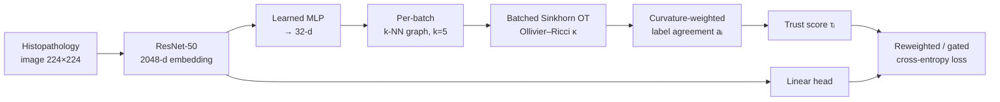

<div align="center">

# 🔬 Curvature-Based Trust Gating for Poisoning-Robust Histopathology Classification

### A Cross-Domain Evaluation of Ollivier–Ricci Curvature on CNN Embeddings

[](https://www.python.org/)
[](https://pytorch.org/)
[](#-datasets)
[](#-statistical-protocol)
[](#-engineering-contributions)
[](LICENSE)

**Moinak Dey · Baljinder Kaur · Roshni Singh · B. Uma Maheshwar**
Chandigarh Engineering College (CGC) · CGC University, Mohali, Punjab, India

</div>

---

## 📌 TL;DR

Label-flip poisoning degrades deep classifiers trained on crowd-sourced or pooled medical imaging data. We build an **Ollivier–Ricci curvature trust gate** over ResNet-50 embeddings that reweights (or discards) training samples by curvature-weighted neighborhood label agreement.

| Setting | Finding |
|---|---|
| **BreaKHis, 10% poison** | ✅ **Hard** gating significantly beats undefended training (Cohen's *d* ≈ 1.6–1.9, survives Holm–Bonferroni) |
| **BreaKHis, 20% poison** | ⚠️ No variant reliably beats baseline at *n* = 13; all trust-gating variants show occasional single-class collapse |
| **PatchCamelyon (preliminary)** | ℹ️ Baseline already near-robust at scale; no gating variant improves on it |

> **Takeaway:** trust gating looks like a **small-data / data-scarcity mitigation**, not a universal poisoning defense. We report the positive result, the failure modes, and the scope condition plainly.

---

## 🧠 Method



**Ollivier–Ricci curvature** on edge (i, j):

```
κ(i, j) = 1 − W₁(mᵢ, mⱼ) / d(i, j)
```

with idleness α = 0.5, W₁ approximated by an entropic Sinkhorn solver (ε = 0.1, 50 iterations).

### Gate modes

| Mode | Description |
|---|---|
| **Soft** | `τᵢ = σ(4aᵢ − 2 + b_yᵢ)`, clamped to [0.1, 1.0], learnable per-class bias to prevent minority collapse |
| **Hard** | Binary keep/discard, `τᵢ ∈ {0.1, 1.0}` via curvature + agreement threshold |
| **Curvature-only** | Ablation: `σ(κ̄ᵢ)` only, no label agreement |

### Baselines & ablations

- **Undefended** — ResNet-50 + standard cross-entropy
- **Small-loss trust** — non-geometric, per-sample loss percentile (soft or hard top-fraction)
- **Bloch-sphere framing** — quantum-inspired geometric trust signal, **evaluated and rejected** (unstable, class collapse at 20%)

---

## 📊 Results

### BreaKHis — test-set performance (mean ± std)

| Poison | Defense | n | Bal. Acc. | Macro-F1 | AUC |
|:-:|---|:-:|:-:|:-:|:-:|
| 10% | None | 5 | 0.817 ± 0.077 | 0.686 ± 0.105 | 0.888 ± 0.062 |
| 10% | Small-loss | 5 | 0.858 ± 0.071 | 0.778 ± 0.091 | 0.937 ± 0.035 |
| 10% | Ricci (soft) | 5 | 0.825 ± 0.073 | 0.689 ± 0.081 | 0.931 ± 0.038 |
| 10% | Ricci (curv.-only) | 5 | 0.835 ± 0.053 | 0.683 ± 0.130 | 0.894 ± 0.057 |
| 10% | **Ricci (hard)** | 5 | **0.888 ± 0.042** | **0.756 ± 0.095** | **0.955 ± 0.033** |
| 20% | None | 13 | 0.681 ± 0.096 | 0.568 ± 0.092 | 0.759 ± 0.111 |
| 20% | Small-loss | 13 | 0.685 ± 0.139 | 0.623 ± 0.118 | 0.740 ± 0.187 |
| 20% | Ricci (soft) | 13 | 0.708 ± 0.168 | 0.600 ± 0.123 | 0.771 ± 0.208 |
| 20% | Ricci (hard) | 13 | 0.738 ± 0.182 | 0.648 ± 0.143 | 0.785 ± 0.229 |

*Full table (including 5% poison) is in the paper.*

### ✅ Confirmatory result — Ricci (hard) vs. baseline, 10% poison

| Metric | Δ | p (paired t) | Cohen's *d* |
|---|:-:|:-:|:-:|
| Balanced Acc. | +0.071 | 0.0213\* | 1.64 |
| Macro-F1 | +0.071 | 0.0232\* | 1.60 |
| AUC | +0.067 | 0.0137\* | 1.88 |

\*Survives Holm–Bonferroni within the 3-test confirmatory family.

### ⚠️ Single-class collapse at 20% poison (n = 13 each)

| Defense | Collapsed | Rate |
|---|:-:|:-:|
| None | 0/13 | 0% |
| Small-loss | 2/13 | 15% |
| Ricci (soft) | 2/13 | 15% |
| Ricci (hard) | 3/13 | 23% |

Baseline vs. pooled trust-gating collapse: Fisher's exact **p = 0.17** — an observed caution, **not** a statistically established finding.

### 🧪 PatchCamelyon — preliminary (n = 1–2, point estimates only)

| Poison | Defense | Bal. Acc. | AUC |
|:-:|---|:-:|:-:|
| 10% | None | 0.886 | 0.946 |
| 10% | Small-loss | 0.897 | 0.957 |
| 10% | Ricci (hard) | 0.891 | 0.945 |
| 20% | None | 0.891 | 0.949 |
| 20% | Ricci (hard) | 0.872 | 0.954 |

Undefended PCam barely degrades from 10% → 20% poison (0.886 → 0.891), unlike BreaKHis (0.817 → 0.681). Not statistically tested.

---

## 🛠️ Engineering Contributions

1. **Numerically stable batched Sinkhorn** — per-edge cost normalization fixes kernel underflow when edges at very different length scales are batched.
2. **Deterministic curvature aggregation** — replaced `scatter_add_` with a reshape-based per-node reduction; GPU runs verified **byte-for-byte identical** across repeated invocations at a fixed seed.
3. **Learned projection layer** (2048 → 32) enabling tractable per-batch curvature on an evolving embedding space.
4. **Discrete vs. continuous gating** comparison, isolated from the choice of trust signal.
5. **Failure-mode-first evaluation** — collapse rate and Levene variance tests reported alongside accuracy metrics.

---

## 📐 Statistical Protocol

- **Patient-wise splits** keyed on `--seed` but independent of the defense → identical test sets across defenses for a given seed → **paired, seed-matched** comparisons
- Paired *t*-test + Wilcoxon signed-rank, Cohen's *d*, post-hoc power analysis
- **Confirmatory vs. exploratory** families, Holm–Bonferroni corrected *within* each family
- Levene's test for run-to-run variance (no defense significantly more stable, p ∈ 0.25–0.95)

---

## 📦 Datasets

| Dataset | Size | Balance | Split |
|---|---|---|---|
| [**BreaKHis**](https://web.inf.ufpr.br/vri/databases/breast-cancer-histopathological-database-breakhis/) | Few thousand images | ~31% / 69% benign/malignant | Patient-wise, rebuilt per seed |
| [**PatchCamelyon**](https://github.com/basveeling/pcam) | 262,144 / 32,768 / 32,768 | 50 / 50 | Official WSI-disjoint, used as-is |

**Attack model:** uniform random label flip of a fraction *p* of training labels (BreaKHis: 5/10/20%; PCam: 10/20%). Validation and test splits stay clean.

---

## ⚙️ Configuration

| Parameter | Value |
|---|---|
| Backbone | ImageNet-pretrained ResNet-50 (not frozen) |
| Optimizer | Adam, lr = 1e-4, batch size 32 |
| Epochs | 15 (BreaKHis) · 2 + mixed precision (PCam) |
| Image size | 224 × 224 |
| Gate | k = 5, α = 0.5, d = 32, ε = 0.1, 50 Sinkhorn iters, aux-loss weight 0.1 |
| Hardware | NVIDIA RTX 3050 Ti, Intel Core i7 |

---

## 🚀 Quick Start

```bash
git clone https://github.com/spaceexplorer06/<repo-name>.git
cd <repo-name>
pip install -r requirements.txt
```

```bash
# Example — adjust script/flag names to match your code
python train.py --dataset breakhis --defense ricci --gate hard --poison 0.10 --seed 42
```

Each run writes a `test_report.json` (accuracy, balanced accuracy, macro-F1, AUC, per-class precision/recall, calibrated threshold).

---

## ⚠️ Limitations

- Random label-flip only; targeted and clean-label attacks not evaluated
- Full statistical protocol applied to BreaKHis only; PCam is preliminary (*n* = 1–2)
- Collapse-rate comparison likely underpowered
- Sinkhorn fidelity to exact OT as a function of ε not characterized
- Projection layer starts random, so early-training curvature is uninformative
- "Seed" varies different things on the two datasets (PCam splits are fixed)

---

## 📚 Citation

```bibtex
@misc{dey2026curvaturetrustgating,
  title  = {Curvature-Based Trust Gating for Poisoning-Robust Histopathology Classification: A Cross-Domain Evaluation},
  author = {Dey, Moinak and Kaur, Baljinder and Singh, Roshni and Maheshwar, B. Uma},
  year   = {2026},
  note   = {Chandigarh Engineering College (CGC), Mohali, India}
}
```

---

## 📬 Contact

**Moinak Dey** — [moinakdey21@gmail.com](mailto:moinakdey21@gmail.com) · [@spaceexplorer06](https://github.com/spaceexplorer06)

<div align="center">

⭐ If this was useful, consider starring the repo.

</div>
